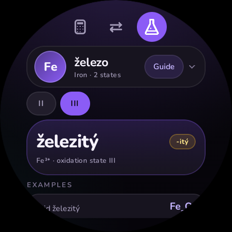
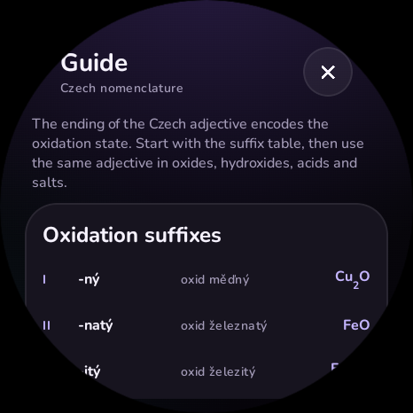

# QalSheet

A stand-alone Wear OS calculator built for round watches, tuned for the **Xiaomi Watch 2 Pro** (466 × 466 px, ~320 dpi, round display).

Three swipeable tabs, one tiny app:

- **Calculator** — large rounded material keys, a second `fx` keypad with 19 scientific functions, DEG/RAD modes, live preview and calculation history.
- **Converter** — length, mass, temperature, volume, area, speed, time and data. Starts at the two examples you asked for: `cm → mm` and `kg → g`.
- **Czech names** — pick an element and an oxidation state and get the Czech adjective (`Fe³⁺ → železitý`), the matching suffix (`-itý`) and example compounds, plus a full nomenclature guide.

| Basic keypad | Scientific keypad | Radians | Error |
| --- | --- | --- | --- |
|  |  |  |  |

| Scientific result | Amount entry |
| --- | --- |
|  |  |

| Converter | Czech names | Nomenclature guide |
| --- | --- | --- |
|  |  |  |

## Calculator

The calculator has two pages inside the Calculator tab. Use the `123` / `fx` switch in the display header:

- **123** is the large numeric keypad.
- **fx** is a full-size scientific function page. Tapping a function inserts it into the expression and returns to the numeric page so you can keep typing or press `=`.

Supported functions:

`sin cos tan asin acos atan ln log √ x² x^y π e ( ) ! % ± 1/x`

plus digits, decimal, `+ − × ÷`, clear, backspace and equals.

Examples:

| Expression | Result |
| --- | --- |
| `sin(30)` in DEG | 0.5 |
| `sin(π÷2)` in RAD | 1 |
| `2^3^2` | 512 |
| `5!` | 120 |
| `200×10%` | 20 |
| `2π` | 6.283185… |

The parser is a hand-written recursive-descent parser (no `eval`). It supports right-associative powers, unary minus, implicit multiplication (`2π`, `2(3+4)`, `2sin(30)`) and graceful errors for divide-by-zero, invalid trig/log/root domains and overflow.

The `DEG` / `RAD` pill is always visible in the display header. Trig history entries remember their angle mode and show it in the history list.

## Watch-first details

- Layout checked against the round 466 × 466 display: the outer key columns are inset to the safe circle and the bottom rows have deliberately centered, reduced key counts.
- Rotating crown switches tabs; lists support rotary scrolling.
- Full-screen watch dialogs for history, unit selection, amount entry, element selection and the guide.
- Haptic ticks on keys and long-press feedback for equals and destructive actions.
- Dark Material-You-inspired palette based on the QuickCalc look: ink, slate, violet and teal, rounded Nunito type.
- Fully offline and standalone. No network permission.

## Requirements

- JDK 17 or newer (the project was built with JDK 21).
- Android SDK Platform 35 and Build Tools 35.0.0.
- Android Studio Ladybug or newer, or the command line. The Gradle wrapper (8.13) downloads the rest.

`local.properties` is intentionally not committed. Set `sdk.dir=...` locally or let Android Studio create it.

## Build and install

```bash
./gradlew :app:assembleDebug
adb install -r app/build/outputs/apk/debug/app-debug.apk
```

Run the JVM unit tests:

```bash
./gradlew :app:testDebugUnitTest
```

On the Xiaomi Watch 2 Pro: enable Developer options and Wireless debugging on the watch, pair it with your computer, then run the `adb install` command. The app is a Wear OS standalone app, so it does not need the phone.

## Czech nomenclature notes

The chemistry tab uses a curated table, not machine translation. Czech oxidation adjectives are irregular (`vápník → vápenatý`, `chlor → chlorečný`), so they are stored explicitly.

The suffix system follows the standard school rules:

| Oxidation | Suffix |
| --- | --- |
| I | -ný |
| II | -natý |
| III | -itý |
| IV | -ičitý |
| V | -ičný / -ečný |
| VI | -ový |
| VII | -istý |
| VIII | -ičelý |

`-ečný` is used for `fosforečný`, `chlorečný` and `bismutečný`; other elements use `-ičný`. Oxide formulas are generated from the selected oxidation state. The guide also covers binary compounds, hydroxides, acids, salts and a short IUPAC organic-naming summary.

This is an educational helper. For homework or lab work, verify unusual compounds against a current textbook or IUPAC reference.

## Project layout

```
app/src/main/java/com/qalsheet/
  MainActivity.kt          entry point
  QalSheetApp.kt           three-tab Wear pager
  ui/                      theme, typography, custom icons, dialogs, page switch
  calc/                    expression parser, calculator state and screens
  convert/                 unit data, conversion state and screen
  chem/                    Czech element data, guide content and screen
app/src/test/              JVM unit tests
```

## Font

Nunito is bundled under the SIL Open Font License. See [licenses/nunito-OFL.txt](licenses/nunito-OFL.txt).
