# QalSheet

A stand-alone Wear OS calculator built for round watches, tuned for the **Xiaomi Watch 2 Pro** (466 × 466 px, ~320 dpi, round display).

Three swipeable tabs, one tiny app:

- **Calculator** — large rounded material keys, a second `fx` keypad with 19 scientific functions, DEG/RAD modes, live preview and calculation history.
- **Converter** — length, mass, temperature, volume, area, speed, time and data. Starts at `cm → mm` and `kg → g`.
- **Algebra** — solve linear and polynomial equations with any letters, including brackets, fractions, powers, multiple real roots and symbolic multi-letter answers.

| Basic keypad | Scientific keypad | Radians | Error |
| --- | --- | --- | --- |
| 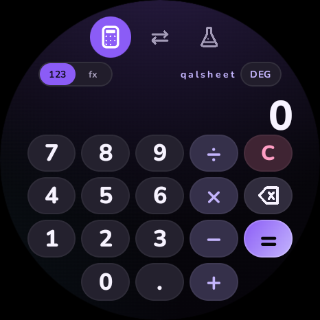 | 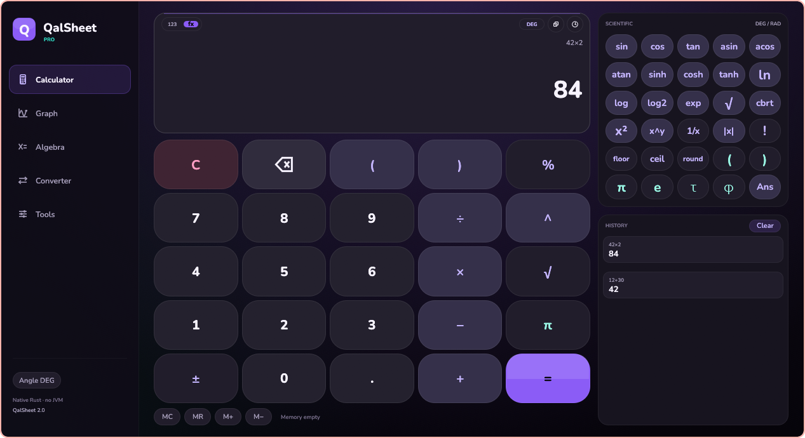 | 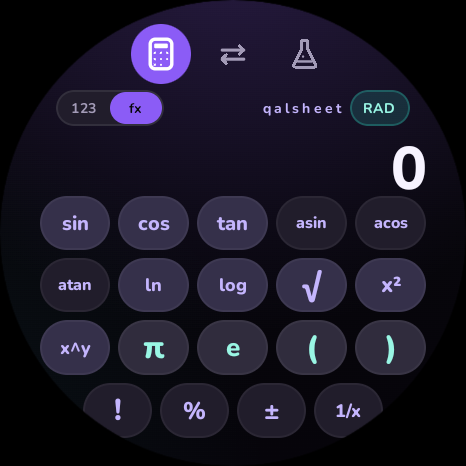 | 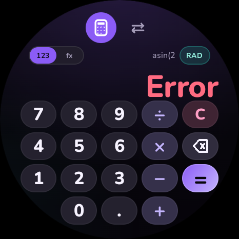 |

| Algebra | Solved | Multiple letters | Letter picker |
| --- | --- | --- | --- |
| 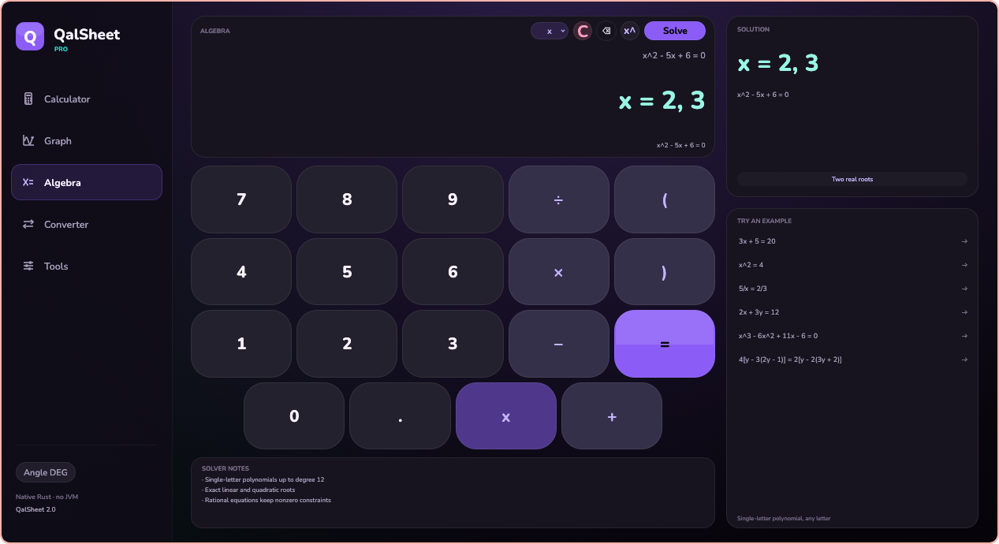 | 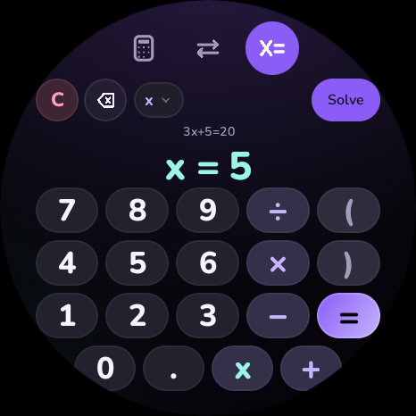 | 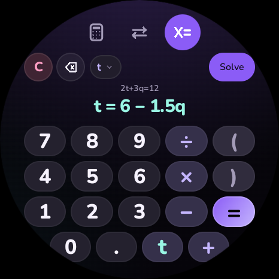 | 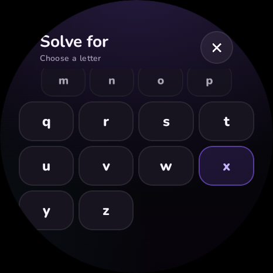 |

| Scientific result | Converter | Amount entry |
| --- | --- | --- |
| 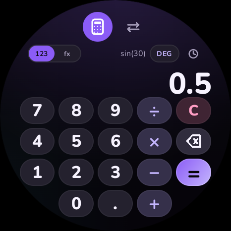 | 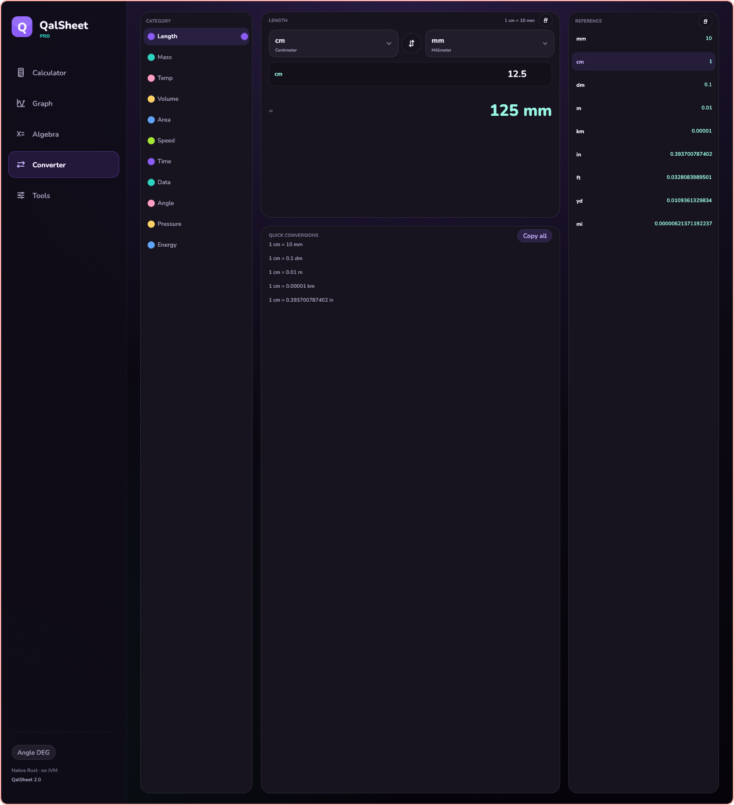 | 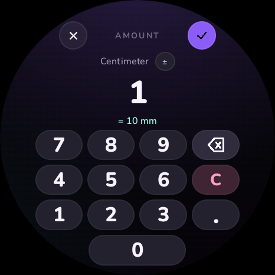 |

## Calculator

The calculator has two pages inside the Calculator tab. Use the `123` / `fx` switch in the display header:

- **123** is the large numeric keypad.
- **fx** is a full-size scientific function page. Tapping a function inserts it into the expression and returns to the numeric page so you can keep typing or press `=`.

Supported functions:

`sin cos tan asin acos atan ln log √ x² x^y π e ( ) ! % ± 1/x`

plus digits, decimal, `+ − × ÷`, clear, backspace and equals.

Examples:

| Expression | Result |
| --- | --- |
| `sin(30)` in DEG | 0.5 |
| `sin(π÷2)` in RAD | 1 |
| `2^3^2` | 512 |
| `5!` | 120 |
| `200×10%` | 20 |
| `2π` | 6.283185… |

The parser is a hand-written recursive-descent parser (no `eval`). It supports right-associative powers, unary minus, implicit multiplication (`2π`, `2(3+4)`, `2sin(30)`) and graceful errors for divide-by-zero, invalid trig/log/root domains and overflow.

The `DEG` / `RAD` pill is always visible in the display header. Trig history entries remember their angle mode and show it in the history list.

## Algebra

A dedicated equation editor solves linear and polynomial equations in one unknown, with any letter `a–z`:

| Equation | Answer |
| --- | --- |
| `3x + 5 = 20` | `x = 5` |
| `3t + 5 = 20` | `t = 5` |
| `2(x − 3) = 4x` | `x = −3` |
| `x/2 + 3 = 7` | `x = 8` |
| `4[y − 3(2y − 1)] = 2[y − 2(3y + 2)]` | `y = 2` |
| `5/x = 2/3` | `x = 7.5` |
| `x² = 4` | `x = −2, 2` |
| `x³ − 6x² + 11x − 6 = 0` | `x = 1, 2, 3` |
| `2t + 3q = 12` | `t = 6 − 1.5q` (solved for `t`) |

- Tap the letter pill in the display header to choose the unknown. The variable key on the keypad inserts that letter.
- Tap the `x^` key in the display header to insert a power, then type the whole-number exponent. Unicode forms such as `x²` and `x³` are also accepted.
- The solver handles parentheses, nested `[ ]` / `{ }` groups, decimals, fractions, negative coefficients and the unknown on both sides.
- Nested groups follow textbook notation automatically: the grouping key inserts `(`, then `[`, then `{` as you go deeper. Its label updates, and the close key inserts the matching `)`, `]` or `}`.
- The unknown may appear in a denominator. Roots that would divide by zero are rejected.
- Linear equations with several letters return a symbolic answer for the selected letter.
- If only one letter appears, it is detected automatically, so `3y + 5 = 20` works even if the selected letter is still `x`.
- Quadratic equations return both real roots. Equations of degree 3–12 use numeric real-root finding and show all distinct real roots; an equation with only complex roots reports `No real solution`.
- Equations with powers and more than one letter show a clear error; use one letter when the equation is nonlinear.
- `=` inserts the separator; press it again or use **Solve** to evaluate.

The algebra parser is separate from the scientific calculator parser. It expands integer powers into polynomials and rational quotients, then solves the resulting equation. Linear and quadratic cases are exact; higher-degree real roots are numeric and rounded to six decimals.

## Converter

- Length, mass, temperature, volume, area, speed, time and data.
- Full unit pickers, a custom amount keypad, a sign toggle and a swap control.
- Decimal (`kB = 1000 B`) and binary (`KiB = 1024 B`) data units are labelled separately.
- Defaults include `cm → mm`, `kg → g`, `°C → °F`, `l → ml`, `m² → cm²`, `km/h → m/s`, `h → min`, and `MB → GB`.

## Watch-first details

- Layout checked against the round 466 × 466 display: outer key columns are inset to the safe circle and the bottom rows use deliberately centered, reduced key counts.
- Rotating crown switches tabs; lists support rotary scrolling.
- Full-screen watch dialogs for history, unit selection, amount entry and the algebra letter picker.
- Haptic ticks on keys and long-press feedback for equals and destructive actions.
- Dark Material-You-inspired palette based on the QuickCalc look: ink, slate, violet and teal, rounded Nunito type.
- Fully offline and standalone. No network permission.

## Requirements

- JDK 17 or newer (the project was built with JDK 21).
- Android SDK Platform 35 and Build Tools 35.0.0.
- Android Studio Ladybug or newer, or the command line. The Gradle wrapper (8.13) downloads the rest.

`local.properties` is intentionally not committed. Set `sdk.dir=...` locally or let Android Studio create it.

## Build and install

```bash
./gradlew :app:assembleDebug
adb install -r app/build/outputs/apk/debug/app-debug.apk
```

Run the JVM unit tests:

```bash
./gradlew :app:testDebugUnitTest
```

On the Xiaomi Watch 2 Pro: enable Developer options and Wireless debugging on the watch, pair it with your computer, then run the `adb install` command. The app is a Wear OS standalone app, so it does not need the phone.

## Project layout

```
app/src/main/java/com/qalsheet/
  MainActivity.kt          entry point
  QalSheetApp.kt           three-tab Wear pager
  ui/                      theme, typography, custom icons, dialogs, page switch
  calc/                    expression parser, calculator state and screens
  convert/                 unit data, conversion state and screen
  algebra/                 equation editor, polynomial solver, letter picker
app/src/test/              JVM unit tests
```

## Font

Nunito is bundled under the SIL Open Font License. See [licenses/nunito-OFL.txt](licenses/nunito-OFL.txt).
