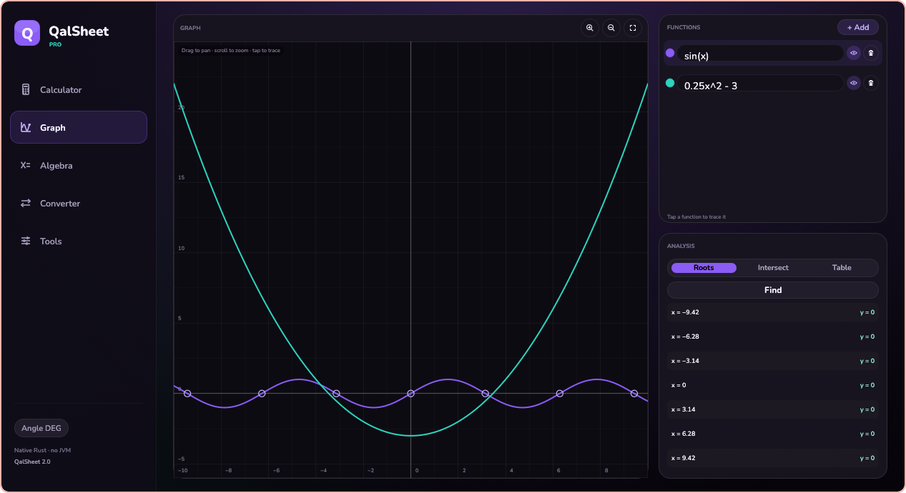
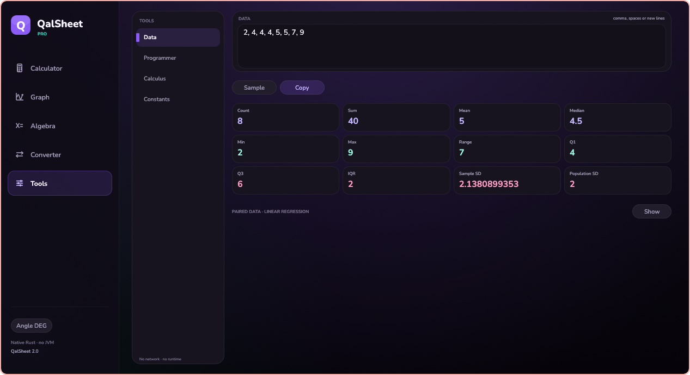
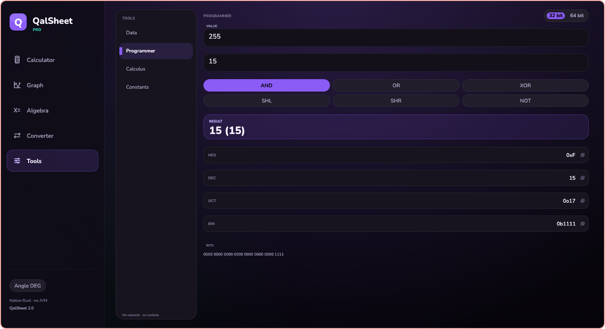
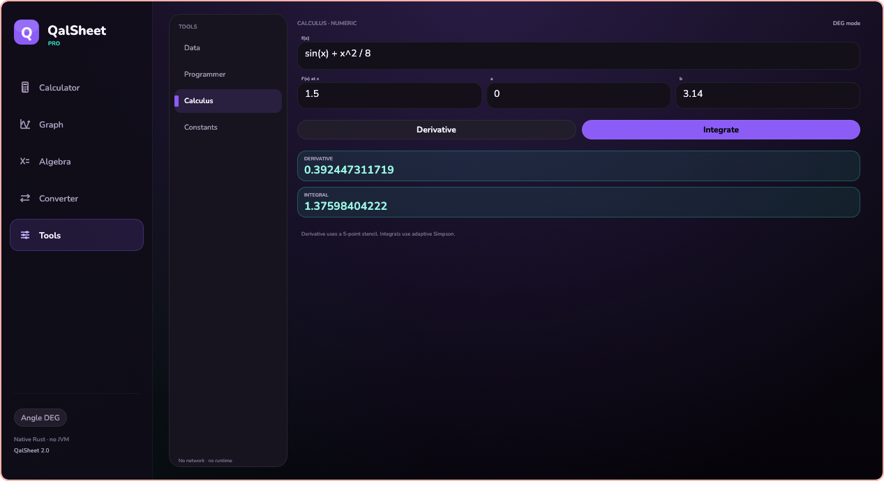
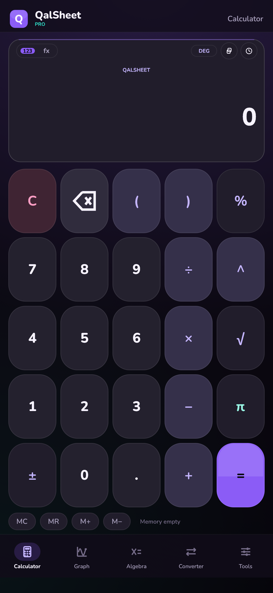
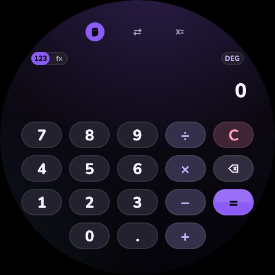
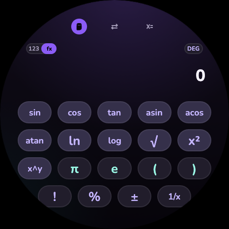
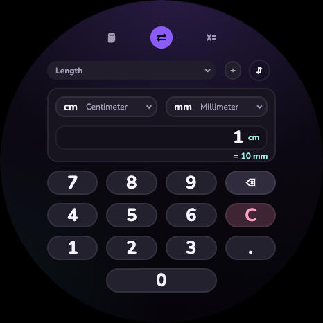
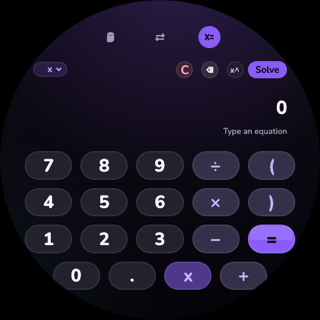

# QalSheet 2.0

A native scientific calculator for **Linux**, **Android** and **Wear OS**, written in Rust with
[egui/eframe](https://github.com/emilk/egui). It is not a WebView wrapper, not Electron, and it
does not start a JVM. The Linux release is a single ~8 MB binary; the Android app contains three
native ABIs and no DEX code.

The look follows the original Wear OS app: ink-black background, Nunito, violet actions, teal
constants, round keys and pills.


## What it does

| Tab | Features |
| --- | --- |
| **Calculator** | Scientific keypad, DEG/RAD, implicit multiplication, powers, roots, logs, trig, factorial, percent, memory (`MC/MR/M+/M-`), `Ans`, 100-entry history, copy result |
| **Graph** | Up to 6 functions, pan/zoom, trace readout, x-intercepts, intersections, value table, auto-fit |
| **Algebra** | Polynomial equations through degree 12, exact linear/quadratic roots, numeric higher roots, multi-letter linear solutions, rational equations with domain constraints, examples |
| **Converter** | 11 categories: length, mass, temperature, volume, area, speed, time, data, angle, pressure, energy; search-free unit picker, swap, live keypad, reference table |
| **Tools** | Statistics and quartiles, paired linear regression, base-n/bitwise programmer mode, numeric derivative and definite integral, searchable physical constants |

The graph, statistics, programmer, calculus and constants tools are deliberately **not** on the
watch. Wear keeps the original three tabs (Calculator, Converter, Algebra) and the original
5 × 4 calculator keypad.

### Screens

| Graph | Algebra |
| --- | --- |
|  |  |

| Converter | Data & statistics |
| --- | --- |
|  |  |

| Programmer | Calculus |
| --- | --- |
|  |  |

<details>
<summary>Android phone and Wear OS screens</summary>



| Calculator | Scientific |
| --- | --- |
|  |  |

| Converter | Algebra |
| --- | --- |
|  |  |

</details>

## Install

### Arch Linux

The repository contains a `PKGBUILD` that builds and installs the desktop binary, desktop entry
and icon. A prebuilt Arch package is also in `dist/`:

```bash
makepkg -si
# or
sudo pacman -U dist/qalsheet-2.0.0-1-x86_64.pkg.tar.zst
qalsheet
```

### AppImage (any x86_64 Linux with X11/Wayland and OpenGL)

```bash
chmod +x dist/QalSheet-2.0.0-x86_64.AppImage
./dist/QalSheet-2.0.0-x86_64.AppImage
```

The AppImage is intentionally small: the binary relies only on system glibc, libm, libgcc and the
normal X11/Wayland/OpenGL stack. It does not bundle a browser engine or a JVM.

Checksums for every artifact are in `dist/SHA256SUMS`.

### Android phone

```bash
adb install -r dist/com.qalsheet.pro-2.0.0.apk
```

### Wear OS

```bash
adb install -r dist/com.qalsheet-2.0.0.apk
```

Both APKs are **debug-signed** so they can be sideloaded. They share the same native Rust code;
the phone build enables the five-tab layout and the watch build enables the three-tab round layout.

## Build from source

Requirements: Rust 1.95+ (edition 2024), JDK not required to run. For Linux the usual X11/Wayland
development libraries are enough.

```bash
cargo build --release -p qalsheet-desktop
./target/release/qalsheet

# tests
cargo test --workspace

# AppImage (downloads linuxdeploy/appimagetool on first run)
./scripts/build-appimage.sh
```

### Android / Wear OS

1. Install the Android SDK and NDK (r27 or newer).
2. Add the Rust targets:
   ```bash
   rustup target add aarch64-linux-android armv7-linux-androideabi x86_64-linux-android
   ```
3. Point the build script at the SDK:
   ```bash
   export ANDROID_HOME="$HOME/Android/Sdk"
   export ANDROID_NDK_ROOT="$ANDROID_HOME/ndk/27.2.12479018"
   ./scripts/build-android.sh all
   ```
   APKs are written to `dist/`. Pass an ABI list to build one ABI, for example
   `./scripts/build-android.sh phone x86_64`.
4. Install with `adb install -r ...`.

The app uses `android.app.NativeActivity` with `android:hasCode="false"`. There is no Java,
Kotlin, DEX or WebView in the application package; the only build-time JVM use is Android's
`apksigner` tool.

## Architecture

```
crates/
  qalsheet-core/      pure Rust, dependency-free math and state
    expr.rs           recursive-descent expression compiler + AST evaluator
    calculator.rs     calculator/history/memory/function-key semantics
    algebra.rs        sparse polynomial + rational solver (Durand–Kerner)
    graph.rs          root finding, intersections, tables, nice grid steps
    units.rs          11 unit categories and affine conversion
    stats.rs          quartiles, standard deviations, regression
    programmer.rs     bases and bitwise operations
    calculus.rs       5-point derivative, adaptive Simpson integral
    format.rs         12-significant-digit display formatting
  qalsheet-ui/        shared egui UI for desktop, phone and watch
    theme.rs          palette, Nunito, painting helpers
    widgets.rs        keys, pills, fields, modals
    screens/          calculator, graph, algebra, converter, tools
  qalsheet-desktop/   Linux binary (eframe/glow)
  qalsheet-android/   Android NativeActivity cdylib
  qalsheet-wear/      Wear OS NativeActivity cdylib
```

The core has no UI dependency and is covered by unit tests. The three frontends share the same
screens and state; only the tab set, safe insets and watch-sized layout differ.

### Performance notes

- Release profile uses `lto = "fat"`, `codegen-units = 1`, `panic = "abort"` and symbol stripping.
- Expression compilation happens once; graph sampling reuses the AST instead of reparsing text.
- The desktop binary is ~8.4 MB and typically starts in well under a second.
- One-ABI APK ≈ 3 MB; universal APK (arm64-v8a, armeabi-v7a, x86_64) ≈ 8.1 MB.
- No background services, no network permissions, no analytics, no persistence database.

## Controls

- **Calculator:** physical digits, `+ - * /`, `^`, parentheses, Enter (`=`), Backspace and Esc
  (`C`) work on desktop. On Android the custom keypad is used.
- **Graph:** drag to pan, scroll or pinch to zoom, tap to set a trace point, double tap to reset.
- **Text fields** use the platform keyboard (system keyboard on Android, physical keyboard on
  Linux) and update results live.

## Known limitations

- History, memory and current tab are in memory only; they reset when the process is killed.
- Graph is real-valued; no parametric/polar/3D plotting yet.
- Algebra reports only real roots and does not show complex roots or full step-by-step proofs.
- Watch has no graph or tools by design.
- APKs are debug-signed sideload builds, not Play Store artifacts.
- AppImage expects a working X11 or Wayland session with OpenGL; that is the standard Arch setup.

## License

MIT for the application code. Nunito is licensed under the SIL Open Font License; see
`licenses/nunito-OFL.txt` and `crates/qalsheet-ui/fonts/OFL.txt`.
